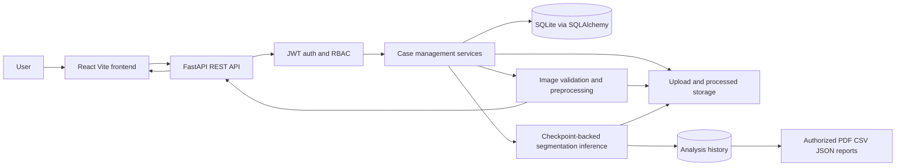

# System architecture

## Overview

## Components

| Component | Responsibility |
| --- | --- |
| React frontend | Login, cases, upload, preprocessing comparison, admin screens |
| FastAPI | REST API, validation, OpenAPI/Swagger |
| Auth and RBAC | bcrypt passwords, JWT, centralized permission checks |
| Case services | Ownership, metadata, status |
| Image services | Safe upload, original preservation, protected download |
| Preprocessing pipeline | Modular OpenCV/NumPy/Pillow/pydicom operations |
| SQLite | Users, cases, images, preprocessing and segmentation history, audit logs |
| File storage | `backend/uploads`, `backend/processed`, `backend/analysis` (not in frontend public assets) |

The frontend never reads another user's files from disk. It only calls authenticated APIs.

## Request flow: login to preprocessing

1. User registers or logs in.
2. Backend verifies credentials, writes an audit event, and returns a JWT.
3. Frontend stores the token and sends `Authorization: Bearer` on later requests.
4. User creates a case. Backend stores metadata and ownership.
5. User uploads an image. Backend validates type/size/readability, stores a unique filename, and keeps the original bytes unchanged.
6. User starts preprocessing with explicit parameters.
7. Pipeline copies pixel data in memory, writes a **new** processed PNG, records history, and updates case status.
8. Frontend displays Original Image and Preprocessed Image side by side using protected image endpoints.

## Segmentation flow

1. An authorized case user requests analysis; the backend chooses the latest uploaded source image.
2. The model checkpoint is loaded from configured backend storage and receives the image as a working copy resized to its stored model input dimension.
3. The backend stores binary mask, overlay, candidate boxes, and probability heatmap as private artifacts, and writes analysis metadata to the same database.
4. Artifact retrieval and reports enforce the same case-access checks as case images.
5. Candidate regions are pixel components, not validated clinical stenosis measurements. Severity and percent narrowing are omitted.

## Role-permission matrix

| Permission | Administrator | Radiologist | Researcher | Data scientist |
| --- | --- | --- | --- | --- |
| Manage users / audit logs | Yes | No | No | No |
| Read all cases | Yes | No | No | No |
| Create / update / delete own cases | Yes | Yes | Yes | Yes |
| Upload and preprocess | Yes | Yes | Yes | Yes |
| Dataset summary / EDA API | Yes | No | No | Yes |

Default public registration role: **researcher**.
