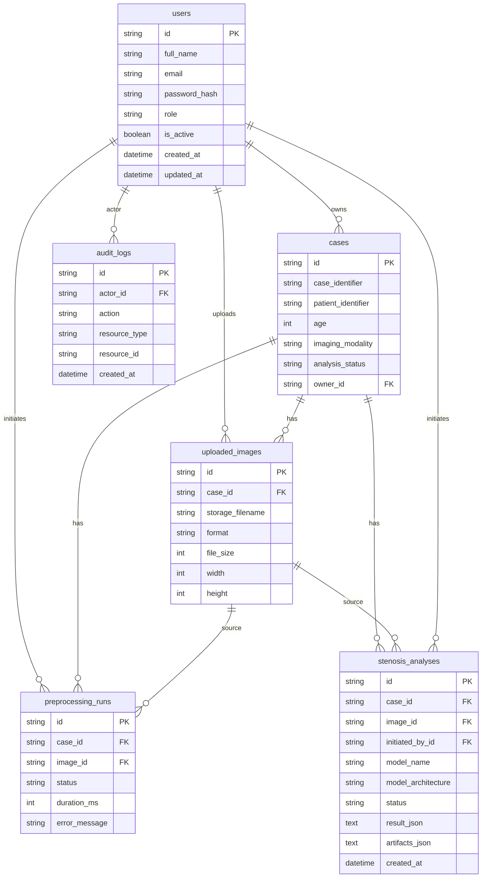

# Database schema

Analysis payloads are persisted in the existing `stenosis_analyses.result_json` and `artifacts_json` columns. They may contain the checkpoint SHA-256 used for lesion inference, optional Integrated Gradients metadata, optional exact-match ARCADE comparison identity/metrics/per-candidate overlap, and generated artifact filenames. No schema change is needed for these fields. Legacy analysis rows remain valid; they have no retroactively inferred checkpoint hash, and same-model attribution is refused for them. Ground-truth comparisons use the stored prediction mask and persist only after a data-scientist/administrator invokes the API for a case they can access. Artifacts are served through the same case-authorized endpoint. The case_008 comparison has been saved additively to its existing analysis payload through the comparison handler, with an audit row and protected comparison artifact. A standalone copy is also in `reports/ground_truth_comparison/`.

The current additive Alembic chain adds missing application tables on fresh or legacy installations but deliberately does not alter columns in pre-existing tables. Run migrations against a temporary copy first for non-default/custom schemas; preserve a verified backup before a real upgrade. Startup `create_all` creates missing tables only and is not a substitute for column migrations.

Image bytes are **not** stored in SQLite. Only metadata and safe storage names are stored.

Analysis records store model outputs and artifact filenames; artifact images live in `backend/analysis`. Existing databases are extended additively at startup and existing user data is retained. `alembic upgrade head` is tested on fresh and legacy partial SQLite schemas; it creates missing tables, preserves existing rows, and does not alter columns of tables that already exist. Back up and review a customized target schema before applying migrations.

No lumen-measurement database migration was added. Existing analysis `result_json` already holds the guarded diameter payload; the new optional pixel-diameter/location/quality keys require no schema change and remain null/unavailable for current inference. No existing analysis rows were backfilled with inferred lumen measurements.
