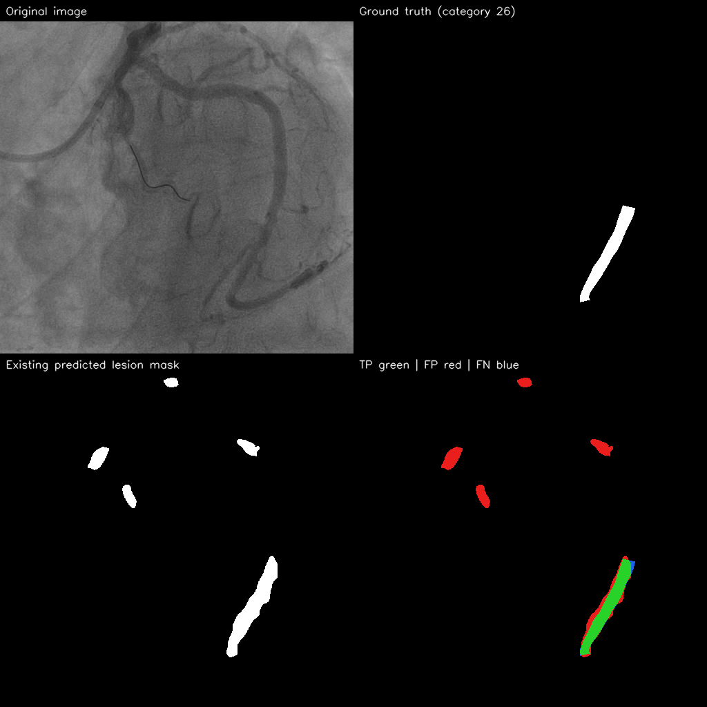

# ARCADE ground-truth comparison — uploaded `case_008`

Comparison date: 2026-11-25. This evaluation uses the stored inference mask and checkpoint; the model was not rerun or retrained.

## Exact image and annotation identity

- Uploaded case identifier: `case_008`
- Stored analysis ID: `cb48c404-6a86-4d76-a167-8cec215b57e2`
- Uploaded original filename: `1.png`
- Configured source: `stenosis/train/images/1.png`
- Annotation file: `stenosis/train/annotations/train.json`
- COCO image ID: `1`
- COCO dimensions: 512 × 512
- Matching annotation ID: `98`
- Category ID: `26` (`stenosis`)
- Uploaded and source image SHA-256: `e285e6f9515aedeb4d126182475dc43cfee8f8594ecdfa8023c9df0a97aef8e1`
- Checkpoint: `best_stenosis_unet_optimized.pth`
- Checkpoint SHA-256 recorded in the analysis and matching the current file: `981a98a7ab1ceee190d1d0c89c45cdeb37dd27b49741f3ffda1487d1f38d288d`
- Stored prediction mask dimensions: 512 × 512; image, COCO record, rasterized annotation, and persisted prediction mask are aligned.

The uploaded image bytes were compared directly to the source image bytes. COCO image ID, annotation ID, category, and dimensions were read from the matching training annotation. The lesion annotation is a polygon label, not a lumen contour.

## Results

| Metric | Result |
|---|---:|
| TP | 2,378 px |
| FP | 2,413 px |
| FN | 92 px |
| Dice | 0.655006 |
| IoU | 0.486996 |
| Precision | 0.496347 |
| Recall | 0.962753 |
| Ground-truth pixels | 2,470 |
| Predicted pixels | 4,791 |

## Existing candidate overlap

| Candidate | Predicted pixels | Overlap with annotation | Fraction of candidate | Result |
|---|---:|---:|---:|---|
| 5 | 3,100 | 2,378 | 0.767097 | Overlaps category-26 label |
| 3 | 597 | 0 | 0 | No overlap |
| 4 | 414 | 0 | 0 | No overlap |
| 1 | 233 | 0 | 0 | No overlap |
| 2 | 447 | 0 | 0 | No overlap |

The displayed candidate IDs are the persisted candidate identifiers; their order follows the stored inference result. TP/FP/FN are pixelwise category-26 mask counts. Candidate overlap means only that the predicted connected component intersects the lesion polygon.

## Visual comparison

The image is a 2×2 panel: original angiography, ARCADE category-26 ground truth, existing predicted mask, and an overlay where green is TP, red is FP, and blue is FN.

Machine-readable output: [comparison JSON](../reports/ground_truth_comparison/case_008_analysis_cb48c404.json).

## Interpretation limits

This is a single-image comparison to the ARCADE train split and is not independent validation. It is not a clinical stenosis percentage, lumen diameter, severity grade, or evidence of clinical performance. The active checkpoint was preserved. The standalone report and visualization are under `reports/ground_truth_comparison/`. The comparison was also saved additively through the application comparison handler into the existing analysis record and protected artifact store, with an administrator audit entry. No existing result fields or files were replaced.
