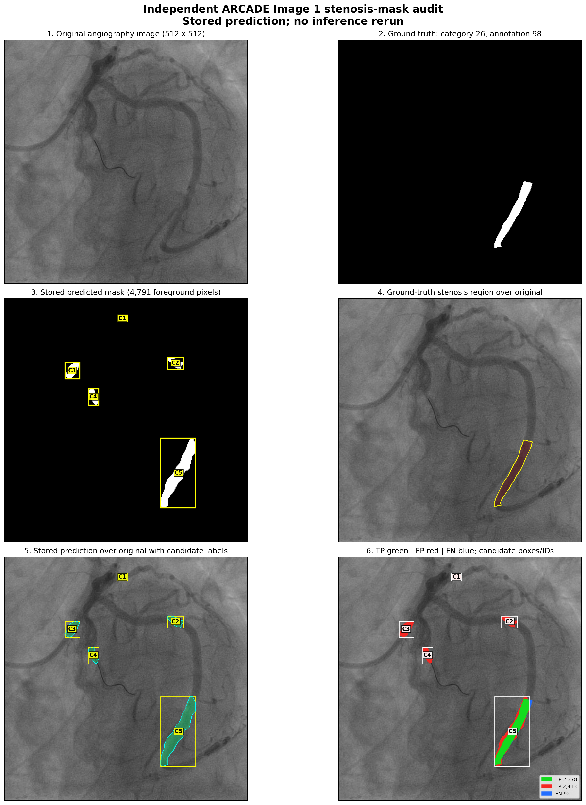

# Independent stenosis-mask audit ? ARCADE Image 1

Audit date: 2026-11-25. Read-only source/prediction audit. The model was not rerun or retrained; the stored mask and existing analysis record were used.

## Identity and alignment

- Dataset image: `stenosis/train/images/1.png`; SHA-256 `e285e6f9515aedeb4d126182475dc43cfee8f8594ecdfa8023c9df0a97aef8e1`.
- Uploaded original: `1.png`; SHA-256 `e285e6f9515aedeb4d126182475dc43cfee8f8594ecdfa8023c9df0a97aef8e1`; byte-identical to dataset image.
- COCO annotation: `stenosis/train/annotations/train.json`; image ID `1`, `512 x 512`; category 26 (`stenosis`).
- Matching category-26 annotation ID(s): `[98]`; 1 polygon(s) unioned. All annotations on image: IDs `[98]`, category IDs `[26]`.
- Stored analysis ID `cb48c404-6a86-4d76-a167-8cec215b57e2` references uploaded image record `90903618-b060-4fab-ac20-cf4ab7fbe2ee`; its persisted mask is `cb48c404-6a86-4d76-a167-8cec215b57e2_mask.png` (512 x 512). All image/mask dimensions align.

## Prediction provenance

- Checkpoint: `best_stenosis_unet_optimized.pth`, current SHA-256 `981a98a7ab1ceee190d1d0c89c45cdeb37dd27b49741f3ffda1487d1f38d288d`; matches SHA-256 recorded in analysis.
- Detected architecture: `legacy_unet`. Stored result architecture: `legacy_unet`; checkpoint input size `256`; epoch `47`.
- Metadata note: the database row `model_architecture` column is NULL; embedded analysis metadata resolves to `legacy_unet`, and the checkpoint metadata names `UNet` (state-dict detection resolves it to `legacy_unet`). This is a missing redundant DB field, not a conflicting model identity.
- Threshold `0.55` from validation macro Dice; minimum component area `20` pixels.
- Preprocessing: RGB image, PIL bilinear resize to 256 x 256, float32 scaling to [0,1], no additional normalization, probability map bilinearly resized to original 512 x 512, thresholding and 20-pixel component filtering.
- No inference was run. The analysis row links mask to the byte-identical uploaded original and stores the checkpoint digest. This DB/artifact provenance is strong linkage but not a cryptographic proof of the original inference computation.

## Independently recalculated metrics

| Metric | Independent value | Previously reported | Difference |
|---|---:|---:|---:|
| TP | 2378 | 2378 | 0 |
| FP | 2413 | 2413 | 0 |
| FN | 92 | 92 | 0 |
| DICE | 0.655006197 | 0.655006000 | 0.000000197 |
| IOU | 0.486995699 | 0.486996000 | -0.000000301 |
| PRECISION | 0.496347318 | 0.496347000 | 0.000000318 |
| RECALL | 0.962753036 | 0.962753000 | 0.000000036 |
| TN | 257261 | not previously reported | ? |
| Specificity | 0.990707580 | not previously reported | ? |

Rasterized ground truth has `2470` positive pixels; prediction has `4791`; image has `262144` total pixels. The values reproduce the previous report; only decimal rounding explains displayed differences. Specificity is mathematically valid for this binary pixel labeling (TN/(TN+FP)) but background-dominated; all pixels outside the annotated lesion polygons are treated as negative, including any unlabeled abnormalities.

## Candidate findings

| Candidate | Box (x,y,w,h) | Pixels | GT overlap | Candidate pixel precision | Finding |
|---:|---|---:|---:|---:|---|
| 1 | [237, 35, 22, 14] | 233 | 0 | 0.000000 | no overlap; false-positive component |
| 2 | [343, 124, 33, 25] | 447 | 0 | 0.000000 | no overlap; false-positive component |
| 3 | [127, 135, 31, 34] | 597 | 0 | 0.000000 | no overlap; false-positive component |
| 4 | [177, 190, 21, 34] | 414 | 0 | 0.000000 | no overlap; false-positive component |
| 5 | [328, 293, 74, 147] | 3100 | 2378 | 0.767097 | overlaps annotation |

Exactly 1 of 5 predicted connected components overlaps the annotation: candidate ID(s) `[5]`. The remaining 4 components are entirely outside the annotated stenosis polygon. The matching candidate still includes false-positive pixels beyond the polygon.

## Visual inspection and verdict

- **Detection of annotated region:** partially detected. Candidate 5 intersects and covers most of the labeled pixels (high recall), but does not isolate the label cleanly.
- **Overlap accuracy:** moderate pixel overlap (Dice/IoU in table); whole-mask precision is low because predicted positive area is almost twice the annotated area.
- **False positives:** yes. Four of five components have zero annotation overlap, plus false-positive pixels within candidate 5.
- **Anatomical location:** the matching component is located over the labeled region in the aligned overlay; the other components are predictions outside this annotated target. Some lie over visible contrast structures, but this single lesion annotation cannot determine whether those regions are other clinically relevant lesions. This is a pixel-label comparison, not clinical assessment of vessels.
- **Fragmentation/extent:** five disconnected components were predicted; one overlaps the lesion. The match component is larger than the ground-truth extent; other four components are false-positive regions relative to the single category-26 annotation.
- **Single-image reliability:** inconclusive. This is one training image and cannot establish generalization or clinical reliability.

No diameter or percent narrowing was calculated. This output does not modify the original analysis record, stored mask, dataset, database, model, or prior comparison artifact.

Machine-readable audit: `arcade_image_1_independent_metrics.json`.
